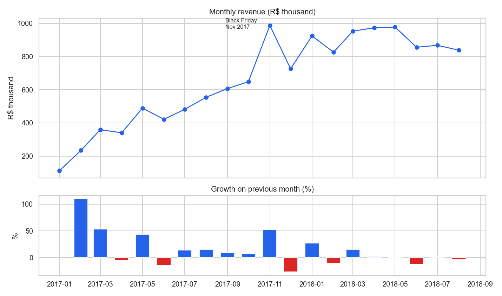
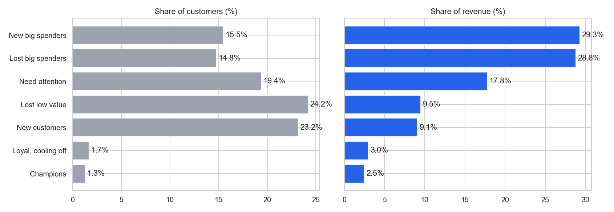
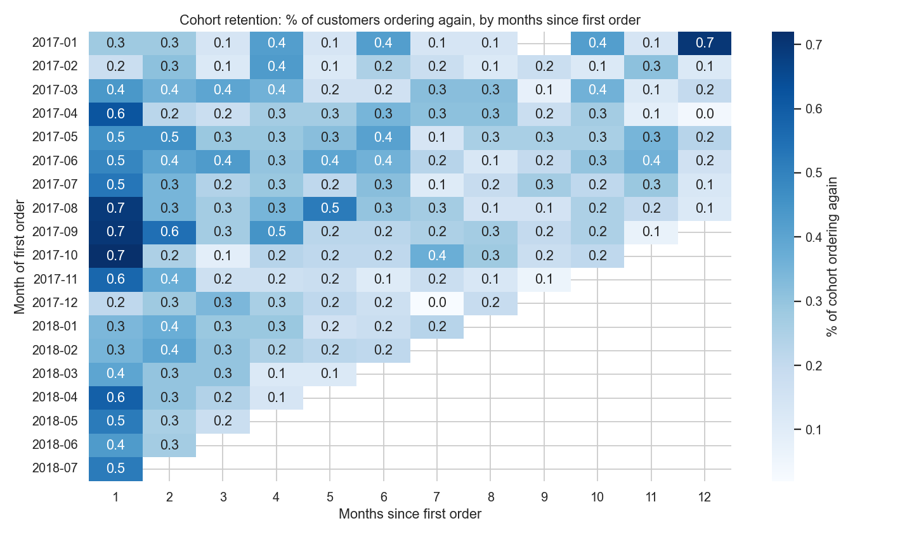
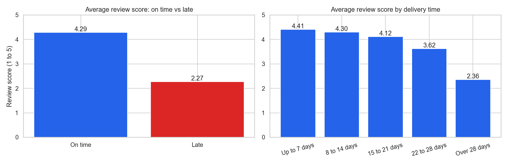

# E-commerce Sales and Customer Analytics

**PostgreSQL | SQL | Power BI | DAX | Python**

An end-to-end analytics project on about 100,000 orders from Olist, a Brazilian online marketplace. Raw data is loaded into PostgreSQL, cleaned with SQL views, analysed with 28 SQL queries, and presented in a Power BI dashboard.

**The main finding:** the business grew fast in 2017 but stalled in 2018, because **97% of customers order once and never return**.



## Business questions

1. How much is the business selling, and is it growing?
2. Which products and regions drive revenue?
3. Do customers come back after their first order?
4. Which customers are most valuable, and which are slipping away?
5. Does delivery performance affect customer satisfaction?

## Key findings

| # | Finding | Evidence |
|---|---|---|
| 1 | Growth has stalled | Monthly revenue flat at R$826K to R$978K through 2018; year-on-year growth fell from 727% (Jan) to 51% (Aug) |
| 2 | Customers do not come back | 97% ordered once; returning customers bring about 3% of revenue each month |
| 3 | A bad first order is not the reason | Repeat rate is about 3% whether the first order got 1 star or 5 |
| 4 | Those who return do so quickly | 51% of second orders happen within 30 days |
| 5 | Revenue is concentrated | Top 10% of customers = 41% of revenue; 18 of 74 categories = 80%; São Paulo = 38% |
| 6 | Late delivery destroys satisfaction | Late orders average 2.27 stars against 4.29 on time; 62% get a bad review against 9% |
| 7 | Late delivery is regional | Rio de Janeiro: 12.1% late. São Paulo: 4.5% |

Headline numbers (January 2017 to August 2018, delivered orders): **96,211 orders, 93,104 customers, R$13.2 million revenue, R$137 average order value, 4.16 average review score.**

## Recommendations

1. **Make retention the priority.** New-customer growth has slowed, and there is almost no repeat business to fall back on. Raising the repeat rate from 3% to 5% would add about 1,900 repeat customers.
2. **Follow up within 30 days of the first order.** That is when returning customers come back. Start with the 14,441 "New big spenders" (15% of customers, 29% of revenue).
3. **Win back "Lost big spenders".** 13,745 customers who spent about R$276 each and have gone quiet.
4. **Fix delivery in Rio de Janeiro first.** It is the second largest market, with nearly three times São Paulo's late rate.
5. **Prepare logistics for Black Friday.** November 2017 had the highest revenue, and the late-delivery rate tripled.

## Project structure

```
sql/
  00_data_quality_checks.sql    7 checks on the raw tables
  01_schema.sql                 Table definitions with keys
  02_views.sql                  Cleaning rules, as materialized views
  03_sales_performance.sql      8 queries: revenue, growth, categories, regions
  04_customer_retention.sql     5 queries: repeat rate, cohorts
  05_customer_segments.sql      3 queries: RFM segments
  06_delivery_and_reviews.sql   5 queries: delivery against review scores
scripts/
  download_data.py              Gets the dataset from Kaggle
  load_to_postgres.py           Creates the database, loads data, builds views
  run_analysis.py               Runs every query, saves results as CSV
  export_powerbi.py             Exports the star schema for Power BI
notebooks/
  analysis.ipynb                Each query, its chart and the finding
powerbi/
  BUILD_GUIDE.md                Step-by-step dashboard build, with expected values
  measures.dax                  30 DAX measures and 3 calculated columns
  data/                         Star-schema CSV files
reports/
  results/                      Output of every query
  figures/                      Charts
tests/                          10 data integrity tests
```

**Start with [notebooks/analysis.ipynb](notebooks/analysis.ipynb).** It shows every query with its result, chart and conclusion.

## How it was built

### 1. Data collection

The [Olist dataset](https://www.kaggle.com/datasets/olistbr/brazilian-ecommerce) from Kaggle: real, anonymised orders from 2016 to 2018. Seven tables are used:

| Table | Rows | One row is |
|---|---|---|
| `orders` | 99,441 | an order |
| `customers` | 99,441 | the customer record attached to an order |
| `order_items` | 112,650 | an item in an order |
| `payments` | 103,886 | a payment (an order can have several) |
| `reviews` | 99,224 | a review |
| `products` | 32,951 | a product |
| `sellers` | 3,095 | a seller |

### 2. Data cleaning

Seven checks on the raw tables ([sql/00_data_quality_checks.sql](sql/00_data_quality_checks.sql)) led to these decisions:

| What the check found | Decision |
|---|---|
| 3% of orders were cancelled, unavailable or still in progress | Count only **delivered** orders as sales |
| 2016 and Sep-Oct 2018 hold a handful of orders each | Analyse **January 2017 to August 2018** |
| `customer_id` is different for every order; 96,096 real people behind 99,441 ids | Identify customers by **`customer_unique_id`** |
| 610 products have no category | Label them `unknown` and keep their revenue |
| 547 orders have more than one review | Use the most recent review |
| 8 delivered orders have no delivery date; 646 have no review | Keep the orders; leave them out of those averages only |

All of these rules are written once, in [sql/02_views.sql](sql/02_views.sql). Every query and the dashboard read from those views, so every number uses the same definitions.

The views are **materialized**: PostgreSQL stores their result. With ordinary views all the analysis queries together took over 5 minutes, because each query recomputed the cleaning. With materialized views they take 9 seconds.

### 3. SQL analysis

28 queries, each answering one named question. Techniques used:

| Technique | Where |
|---|---|
| Joins across 3 or more tables | `v_orders`, `segment_top_category` |
| CTEs (`WITH`) | Most queries |
| `LAG` for month-on-month and year-on-year growth | `monthly_revenue`, `year_over_year` |
| `LEAD` for time to next order | `time_to_second_order` |
| Running totals with `SUM() OVER` | `monthly_revenue`, `top_categories` |
| `ROW_NUMBER` for order sequence and top-N per group | `v_orders`, `segment_top_category` |
| `NTILE` for scoring and deciles | `v_customer_rfm`, `revenue_concentration` |
| `RANK` | `top_categories` |
| Share of total with `SUM(SUM()) OVER ()` | `revenue_by_state`, `rfm_segments` |
| `FILTER (WHERE ...)` conditional aggregates | `new_vs_returning`, `late_vs_on_time` |
| `DISTINCT ON` to keep the latest row | `v_orders` (latest review) |
| Cohort analysis | `cohort_retention` |
| `GENERATE_SERIES` for a date table | `dim_date` |
| `HAVING` | `delivery_by_state`, `lowest_rated_categories` |
| Materialized views and indexes | `02_views.sql` |

### 4. Customer segmentation (RFM)

Customers are scored on Recency and Monetary value (1 to 5, using `NTILE`). Frequency is not scored that way: 97% of customers have exactly one order, so a 1-to-5 score would split identical customers at random. It is used directly, as "one order" or "two or more".



Two segments, "New big spenders" and "Lost big spenders", are 30% of customers and 58% of revenue.

### 5. Retention



Each row is the group of customers who first ordered in that month. In no cohort does even 1% of customers order again in any later month.

### 6. Delivery and reviews



Reviews hold up for the first three weeks of waiting, then collapse.

### 7. Power BI dashboard

The dashboard uses a star schema: two fact tables (`fact_orders`, `fact_order_items`) and three dimensions (`dim_date`, `dim_customer`, `dim_category`).

It is designed as four pages: Executive Overview, Products and Regions, Customers and Retention, Delivery and Satisfaction.

This repository holds everything needed to build it: the star-schema data in [powerbi/data/](powerbi/data/), all 30 measures in [powerbi/measures.dax](powerbi/measures.dax), and the page-by-page steps in [powerbi/BUILD_GUIDE.md](powerbi/BUILD_GUIDE.md). The guide lists the expected value of every card, so the dashboard can be checked against the SQL results.

### 8. Testing

Ten tests check that the numbers are consistent: revenue in the clean views equals an independent sum over the raw tables, the order and item views agree, every customer has exactly one segment, cohort month zero is always 100%, and the Power BI export matches the database.

## Limitations

- 20 months of data: one Black Friday only, and no second full year to confirm seasonality.
- The links found (late delivery and low reviews) are correlations. They suggest a cause but do not prove it.
- No cost, margin or marketing data, so the analysis is about revenue, not profit.
- 30% of "second orders" happen on the same day as the first. They are probably one purchase split in two, so the true repeat rate is likely below 3%.

## Run it

Needs Python 3.11+ and PostgreSQL.

```powershell
python -m venv .venv
.venv\Scripts\Activate.ps1
pip install -r requirements.txt

copy .env.example .env               # then fill in your PostgreSQL password

python scripts/download_data.py      # get the data from Kaggle
python scripts/load_to_postgres.py   # create the database, tables and views
python scripts/run_analysis.py       # run all queries
python scripts/export_powerbi.py     # export tables for Power BI

python -m pytest tests               # data integrity tests
jupyter notebook                     # open notebooks/analysis.ipynb
```

The SQL files can also be run directly in pgAdmin or DBeaver, in numbered order.

## Resume bullets

- Built an end-to-end **SQL analytics project** on **100K e-commerce orders** across 7 PostgreSQL tables; wrote **28 queries** using CTEs, multi-table joins and window functions (LAG, LEAD, NTILE, ROW_NUMBER, running totals).
- Designed a data-cleaning layer with **materialized views**, cutting analysis run time from over 5 minutes to 9 seconds, and validated results with 10 automated data-integrity tests.
- Performed **cohort retention and RFM segmentation** analysis; found **97% of customers purchased only once** and that two segments (30% of customers) drive **58% of revenue**.
- Identified late delivery as the main driver of poor reviews (**2.27 vs 4.29 stars**; 62% vs 9% bad reviews) and located the problem regionally (Rio de Janeiro 12.1% late vs São Paulo 4.5%).
- Designed a **star-schema Power BI model** with **30 DAX measures** (time intelligence, retention, delivery KPIs) for a 4-page dashboard, and delivered 5 business recommendations.

## Interview questions and answers

**1. Walk me through the project.**
I took a public dataset of about 100,000 e-commerce orders in 7 tables and loaded it into PostgreSQL. I ran data quality checks, then wrote the cleaning rules as materialized views. On top of those I wrote 28 queries covering sales, retention, customer segments and delivery. The main finding was that 97% of customers never order again, which explains why revenue stopped growing in 2018. I then built a Power BI dashboard on a star schema and made five recommendations.

**2. What was your most important finding?**
The business has almost no repeat customers. 97% ordered once, and returning customers are only about 3% of monthly revenue. It grew in 2017 purely by adding new customers, and when that slowed in 2018, revenue went flat.

**3. How did you calculate the repeat purchase rate?**
I grouped delivered orders by `customer_unique_id` and counted orders per customer. Customers with more than one order divided by all customers gives 3.0%. The important detail is using `customer_unique_id`. The `customer_id` column is new for every order, so using it would show zero repeat customers.

**4. What is a window function? Give an example from your project.**
A window function calculates across a set of rows related to the current row, without collapsing them like GROUP BY does. For month-on-month growth I used `LAG(revenue) OVER (ORDER BY order_month)` to put last month's revenue next to this month's, then calculated the percentage change.

**5. Difference between ROW_NUMBER, RANK and DENSE_RANK?**
All number rows in an order. On ties: ROW_NUMBER gives different numbers (1, 2, 3), RANK gives the same number and then skips (1, 1, 3), DENSE_RANK gives the same number without skipping (1, 1, 2). I used ROW_NUMBER to number each customer's orders, so `customer_order_number = 1` marks a first purchase.

**6. What is a CTE and why use one?**
A CTE is a named temporary result defined with `WITH`. It lets me build a query in readable steps. For example, in the monthly revenue query the CTE first totals revenue by month, and the main query then applies LAG to those totals.

**7. Explain cohort analysis.**
A cohort is a group of customers who placed their first order in the same month. For each cohort I calculate what share ordered again 1, 2, 3 months later. It separates customer behaviour from business growth: total orders can rise while every cohort still fails to return. Here, no cohort ever had even 1% return in a later month.

**8. Explain RFM. Why did you not score Frequency from 1 to 5?**
RFM segments customers by Recency, Frequency and Monetary value. I scored Recency and Monetary from 1 to 5 with NTILE. I did not do that for Frequency because 97% of customers have exactly one order. NTILE would split those identical customers into different scores arbitrarily. So I used frequency directly: one order, or two or more.

**9. What is the difference between a view and a materialized view?**
A view is a saved query that runs every time you use it. A materialized view stores the result, like a table, and must be refreshed when the data changes. I used materialized views because my cleaning logic has joins and window functions. With plain views, the analysis took over 5 minutes because every query recomputed the cleaning. With materialized views it takes 9 seconds.

**10. How did you handle missing data?**
I kept the rows and limited the effect. Products with no category are labelled `unknown` so their revenue still counts. Orders with no review or delivery date stay in revenue totals and are only left out of the average they cannot contribute to. SQL's AVG ignores NULLs, which does this automatically.

**11. Why did you only use delivered orders?**
Cancelled and unavailable orders never became revenue, and orders still in transit have no delivery date or review yet. Delivered orders are 97% of the data, so little is lost and every metric means the same thing.

**12. How do you know your numbers are right?**
I wrote tests. For example, revenue from the cleaned view must equal a separate sum calculated straight from the raw tables, and the order-level and item-level views must give the same total. I also listed the expected value for each Power BI card from SQL, so the dashboard can be checked against the database.

**13. Late orders get bad reviews. Does late delivery cause bad reviews?**
The data shows a strong link: 2.27 stars when late against 4.29 on time. But it is a correlation. Late orders could differ in other ways, such as bulky items or remote regions. To be sure I would compare within the same category and state, or run an experiment. Given the size of the gap, delivery is still the most likely cause.

**14. You found that a bad first review does not reduce repeat purchases. Explain.**
I expected unhappy customers to return less. The repeat rate was about 3% for every review score. So bad experiences are not what keeps customers away; almost nobody returns either way. That suggests the problem is a missing reason to come back, such as no loyalty programme or follow-up, and not service quality.

**15. Why a star schema in Power BI?**
Fact tables hold the numbers and dimension tables hold what you filter by. Filters flow one way, from dimensions to facts, so a single slicer controls every visual and the DAX stays simple.

**16. What is the difference between a measure and a calculated column in DAX?**
A calculated column is computed once per row and stored. A measure is computed when a visual needs it, under the current filters. I used columns for things I group by, such as "Late" or "On time", and measures for numbers that must respond to filters, such as Total Revenue.

**17. What would you do next?**
Add cost data to analyse profit instead of revenue, separate same-day split orders from true repeat purchases, check whether the delivery effect holds within each category and region, and test a 30-day follow-up offer with an A/B experiment.
